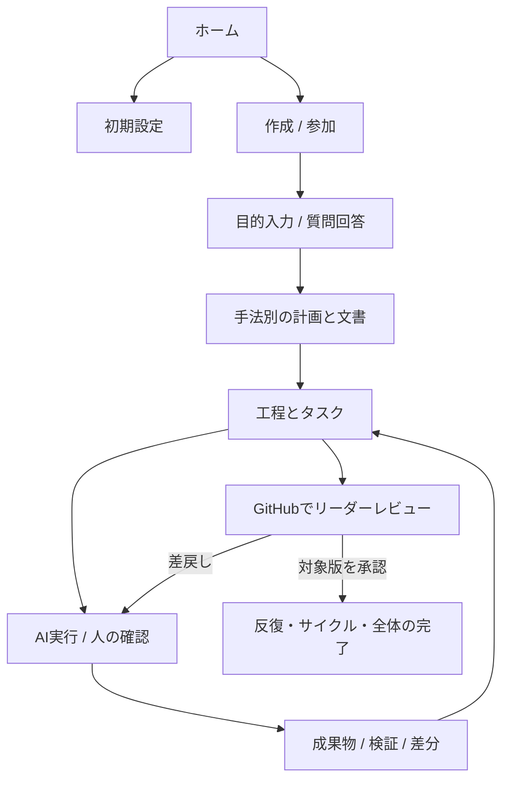

# AI駆動開発システム 詳細設計

版: 0.1 / 2026-10-24

状態: レビュー用詳細設計。実装・実機検証・GitHubでのリーダー承認は未実施。

前提: [要件・構成設計](requirements-and-architecture.md)と追加の文書テンプレート要件に基づく。各PCで独立したexeを起動し、共同作業の連携先はGitHubとする。以下の値は初期設計値で、測定済み性能ではない。

## 1. モジュールと実行構成

| モジュール | 責務 | 主な入出力 |
|---|---|---|
| Launcher | 二重起動防止、API起動、ブラウザ起動、終了 | 起動引数、ローカルセッション |
| Web UI | 対話、進捗、成果物、設定 | ローカルHTTP API、SSE |
| Application API | 入力検証、認可、ユースケース実行 | DTO、SQLiteトランザクション |
| Workflow Engine | 工程・依存関係・確認・完了判定 | 固定版の工程定義、Task |
| Agent Runner | 役割選択、LLM呼出し、toolループ | 実行入力、構造化イベント |
| Tool Broker | 実行許可、パス検証、子プロセス管理 | 型付きtool引数、結果 |
| GitHub Sync | 取得、送信、競合検知、照合 | GitHub REST API、Git |
| Approval Evaluator | リーダー本人・対象版・レビュー状態の確認 | PRとレビュー一覧、判定証跡 |
| Template Service | 選択、変数展開、構造検証 | Markdown、manifest、検証結果 |
| Settings/Secrets | 各PCの設定と資格情報参照 | SQLite、Windows資格情報ストア |

Python/FastAPI、React/TypeScript、SQLite、PyInstallerを実装基盤として採用する設計。ライブラリの厳密なバージョンは初回ビルド時に固定する。APIプロセスとワーカープロセスを分離するが、子プロセス分離だけをセキュリティ上の隔離とは扱わない。

### 1.1 起動と終了

1. Windowsユーザー単位のアプリロックを取得する。起動済みなら既存の画面を開く。
2. `%LOCALAPPDATA%/AIWorkspace/` にDB・設定・ログを配置する。作業領域は初期設定で指定可能。
3. DBバックアップとスキーマ移行を行う。失敗したらワーカーを起動しない。
4. `127.0.0.1` の空きポートにbindする。LANへ公開しない。
5. 一度だけ使える短命の起動コードでブラウザセッションを確立し、URLからコードを除く。以降はHttpOnly/SameSiteのセッションCookieとCSRFトークンを使用する。起動コードをログに残さない。
6. GitHub同期後に中断実行を照合する。勝手に破壊的操作を再実行しない。
7. 終了時は新規実行を止め、チェックポイントを保存する。子プロセスはWindows Job Object等で管理し、終了時に残さない。ブラウザを閉じてもexeは継続し、画面に明示した終了操作またはexe終了で停止する。

初期配布はランタイムと静的UIを含むフォルダー形式とし、その中のexeを起動する。開発対象のGit・Python・Node等は設定画面で検出/指定する。署名・更新時の互換性は配布検証で確認する。

## 2. 画面と操作

全プロジェクト画面に「対話」「工程・進捗」「タスク」「成果物」「設定」のナビゲーションと、同期時刻・未送信件数を表示する。

| URL | 内容と操作 | エラー/待機表示 |
|---|---|---|
| `/` | 最近のプロジェクト、新規、GitHubから参加 | 未設定の接続先 |
| `/setup` | GitHub認証、LLM複数登録、実行環境の確認 | 権限不足、実行ファイル不在 |
| `/projects/new` | 手法、目的、repo、base、リーダー、テンプレート選択 | リーダー未指定は保存可、完了不可 |
| `/projects/:p/dialogue` | 質問・回答、再質問、工程移行の確認 | 未同期回答、競合回答 |
| `/projects/:p/progress` | 工程図、担当別ボード、承認待ち、依存関係 | 他PCの情報の古さ、API制限 |
| `/projects/:p/tasks/:t` | 開始、停止、再試行、引継ぎ、PRリンク | 他PC所有、実行中断、失敗理由 |
| `/projects/:p/artifacts/:a` | 原文・プレビュー・差分・検証・再生成 | 書式違反、旧版への承認 |
| `/settings/models` | プロファイル追加、役割割当、接続テスト | 対応能力不足 |
| `/settings/templates` | Markdown編集/取込、規則、適用先、版、試作 | 未定義変数、重複ID |
| `/settings/skills` | 追加・固定版・有効化・権限 | 取得失敗、未信頼 |
| `/settings/tools` | MCP/コマンド登録、引数、権限、疎通 | 起動失敗、接続不可 |
| `/projects/:p/settings` | 共有設定、リーダー、手法、工程承認方針 | 変更PRの承認待ち |

生成前には、文書種別・テンプレート版・モデル・送信する入力の概要を確認できる。毎回の確認を強制せず、合意済みの範囲は自動続行できる。最終リーダー承認は常に必須。



## 3. ワークフロー定義と状態遷移

### 3.1 手法別の定義

工程定義は `workflow_id + version` で識別し、工程ID、依存工程、成果物種別、役割、確認ゲート、完了条件を持つ。計画には採用定義のハッシュを記録する。依存グラフの循環は登録時に拒否する。

| 手法 | 初期の工程ID | 成果物 |
|---|---|---|
| waterfall | requirements, architecture, design, implementation, verification, delivery, leader_review | 要件、構成、詳細設計、コード、試験報告、完了報告 |
| agile | vision, backlog, iteration_plan, implementation, verification, review, retrospective, leader_review | 目標、バックログ、反復計画、コード、受入結果、振り返り |
| aidlc | initialization, ideation, inception, construction, operation, leader_review | 意図、質問、適応計画、作業単位設計、コード、検証・運用記録 |

AI-DLCの上記IDはアプリ内の工程群。外部ワークフローを同梱する際は採用commitと工程対応を固定し、独自の近似工程を公式実装そのものとは表示しない。条件付き工程は計画時に採否と理由を保存する。

アジャイルの各反復とAI-DLCの各サイクルに最終承認タスクを置く。全体を終了する際にも最終承認タスクを置く。同じ範囲の重複生成は `run_id + scope_id + leader_review` の一意制約で防ぐ。

### 3.2 タスク・実行・同期の状態を分離

| 種類 | 状態 |
|---|---|
| Task | planned, ready, running, waiting_input, waiting_approval, blocked, failed, cancelling, cancelled, succeeded |
| AgentRun | queued, running, paused, interrupted, failed, cancelled, succeeded |
| Sync | local_only, pending, synced, conflict, retry_wait, auth_required |
| WorkflowRun | planning, active, waiting_input, waiting_approval, blocked, completed, cancelled |

`ready` は依存タスク完了と入力確定が条件。`running` は作業所有確認とローカル実行開始後のみ。質問発生で `waiting_input`、人の確認で `waiting_approval`。回答・承認と対象版が一致したら再開する。停止要求は `cancelling` を経て子プロセス停止確認後に `cancelled` とする。再試行はTaskを再利用しAgentRunを新規作成する。

タスクの `succeeded` は成果物検証成功・共有が必要な成果物の同期完了後に確定する。AIの「完了しました」という文章は状態を変更しない。リーダー承認タスクの完了はApproval Evaluatorだけが確定する。ローカル草案生成の成功はAgentRunには記録できるが、共有タスク完了とは区別する。

中断時には最後の確認済みステップから再開する。LLM出力途中は草案として残し、同じモデル呼出しが再現できるとは保証しない。工程完了は必須タスク、成果物、未解決の差戻し、必須承認を再評価して判定する。

## 4. データ設計

### 4.1 ローカルDB

SQLiteの外部キーを有効化し、書込みは専用キューで直列化する。IDはUUID、時刻はUTCで保存しUIでローカル時刻に変換する。全変更に整数versionを持ち、更新条件に現在versionを含める。主要表は以下。

| 表 | 主なカラム | 制約/役割 |
|---|---|---|
| projects | id, repository_node_id, host, owner, repo, base_branch, workflow_id, config_sha | host+repository_node_idは一意 |
| workflow_runs | id, project_id, definition_hash, plan_sha, state | 採用計画を固定 |
| scopes | id, run_id, kind, ordinal, state | iteration/cycle/project |
| tasks | id, scope_id, issue_number, kind, state, owner_ref, version | scope_id+論理キーを一意 |
| task_dependencies | task_id, depends_on | 組合せ一意、循環禁止 |
| agent_runs | id, task_id, device_id, state, model_snapshot, input_hash, checkpoint | 実行履歴を保持 |
| questions | id, task_id, target_revision, body, state | 回答対象版を固定 |
| answers | id, question_id, actor_id, body, revision, sync_state | 競合回答を保持 |
| artifacts | id, task_id, path, commit_sha, content_hash, template_revision, validation_state | パスは作業領域内 |
| approvals | id, scope_id, kind, target_digest, leader_id, state, checked_at | human_gate/leader_finalを区別 |
| approval_evidence | approval_id, pr_number, head_sha, review_id, reviewer_id, review_url | GitHubからの観測証跡 |
| model_profiles | id, provider, endpoint, model_id, capabilities, secret_ref | secret値は含めない |
| role_bindings | project_id, role, model_profile_id | 役割ごとの割当 |
| templates | id, revision, scope, body_path, manifest_json, hash | 固定版を複数保持 |
| skills | id, source_url, commit_sha, hash, enabled, permissions | 有効化はPCごと |
| tools | id, transport, config_json, secret_refs, permissions | 許可と接続方式 |
| outbox | id, project_id, operation_key, kind, payload, state, attempts, next_attempt_at | operation_key一意 |
| remote_cache | project_id, resource_key, etag, payload, observed_at | resource_key一意 |
| events | seq, project_id, type, entity_id, payload, created_at | SSEの単調増加ID |
| audit_log | id, actor_id, action, target, revision, result, created_at | 秘密情報を除去 |

ログ・LLM全文・未同期の回答はローカルに保持する。共有対象として選んだ質問・判断は機密情報を除去してGitに保存する。秘密情報の値はDBに入れず、資格情報ストアの参照だけを保存する。

### 4.2 リポジトリ構造

```text
.ai-dev/
  project.json                  # 手法、リーダーID、ゲート、共有設定
  workflows/<id>/<version>.json # 固定工程定義
  plans/<run-id>.json            # スコープ、タスクID、依存関係
  templates/<id>/template.md
  templates/<id>/manifest.json
  skills/manifest.json           # 取得元、commit、ハッシュ
  records/<scope-id>/decisions/  # 質問・回答と人の判断
  records/<scope-id>/review-manifest.json
docs/                            # 文書。出力パスは設定可能
src/                             # 開発対象。既存構造も利用可能
tests/
```

設定と計画は通常のPRで共有し、baseにマージされた版を新規実行の既定とする。作業中の文書・記録はタスクブランチに保存する。他PCが未マージ成果物を読む場合は、そのブランチとSHAを明示する。資格情報、端末パス、SQLite、詳細ログは共有しない。

IssueはタスクID、担当者、表示状態、作業参照、PRリンクを持つ。計画にないIssueの閉鎖やラベル変更から工程完了を推測しない。構造化状態は所有記録付き作業ブランチのJSONに保存し、Issueは表示用に同期する。IssueとJSONの不一致はUIで警告し、手動編集を無言で消さない。

## 5. GitHub同期と並行作業

### 5.1 取得と送信

画面表示中の初期間隔は30秒、バックグラウンドは120秒。手動同期も提供する。GitHubの指示する待機時間とAPI制限を優先し、遅延を画面に表示する。ETag等の条件付き取得、ページネーション、更新差分の取得を用い、削除・取消しの検知のため定期的な全体照合も行う。端末間で同時刻に集中しないよう間隔に揺らぎを加える。

GitHub公式はWebhookを推奨しているが、本構成は受信用ホストを持たないため条件付きポーリングを採用する。取得・変更APIはPC内のキューで制御し、Retry-Afterやレートリミットを尊重する。[GitHub API best practices](https://docs.github.com/en/rest/using-the-rest-api/best-practices-for-using-the-rest-api)

ローカルの状態更新とoutbox登録を同一DBトランザクションにする。送信失敗時にローカル更新を取り消さず、未同期として残す。タイムアウト後はリモートを照合してから再送する。GitHubは任意の冪等キーを保証しないため、PRはhead/base、Issueは操作IDマーカー、Gitはcommit SHAと参照で照合する。Issue作成の結果が不明で検索にも反映されない間は `uncertain` 相当の待機とし、盲目的に再作成しない。手動照合・関連付けで復旧できるようにする。

### 5.2 作業取得

1. GitHub本人ID、設定版、依存タスク、既存担当を取得する。
2. `refs/heads/ai-work/<task-id>` 用の開始commitを作成する。所有記録にuser_id、device_id、execution_id、task_idを入れる。秘密情報は含めない。
3. 同じ固定名の参照を新規作成する。成功後にその参照を再取得し、自分の所有記録と一致した場合だけ開始する。既存なら取得して表示し、奪わない。
4. タスクごとのworktreeを作り、ownerを確認して実行する。
5. pushは読み取った参照先を親とする通常のfast-forwardに限る。分岐した場合は失敗として停止し、自動force pushしない。

GitHub RESTの参照作成・更新を利用する設計だが、同時作成・保護ルール・権限の組合せは実API試験を必須とする。単なる参照更新APIのforce=falseを汎用compare-and-swapとして扱わない。[GitHub Git references API](https://docs.github.com/en/rest/git/refs)

所有記録はheartbeat期限だけで奪わない。正常な引継ぎは旧PCの停止、未同期解消、引継ぎ記録push、新PCの所有更新確認の順。旧PCで作業が残っていても、所有不一致なら公開操作を停止する。故障したPCからの強制引継ぎはリーダーが状況を確認して明示的に実行する。

同時着手の試験が通らない環境では、自動的な分散取得を無効化し、担当者と利用端末の固定・手動引継ぎに制限する。システム外からの強制pushや悪意ある改変まで排除できるロックではない。

### 5.3 競合と復旧

| 事象 | 処理 |
|---|---|
| 回答の対象版が変化 | 409を返し両回答と対象差分を表示 |
| 基準ブランチ更新 | 新しい基準へ統合しテスト・レビューを再実行 |
| Git競合 | 別の解消タスクを作成。自動解消後もテストとレビュー |
| オフライン | 実行中の草案は保持。新規共有着手と公開操作は待機 |
| GitHub 401 | 認証再設定待ち |
| GitHub 403/429 | 権限不足と制限を区別し待機/設定案内 |
| PC異常終了 | 実行をinterruptedとし、所有確認・副作用照合後に再開 |
| 相手PCの更新途絶 | 最終同期時刻を表示。失敗や完了と断定しない |

## 6. リーダー承認の厳密な判定

### 6.1 対象の固定

リーダーはGitHubの数値user_idで識別し、表示名変更に影響されないようにする。リーダー変更は共有設定のPRで変更し、既存承認を再評価する。PR作者がリーダー本人の場合は別の人間のリーダーが必要で、AIによる代理承認を認めない。

`review-manifest.json` にscope_id、plan_sha、config_sha、対象文書とコードのSHA、テスト証跡、対象PRとhead SHAを保存する。承認タスクの対象ダイジェストはこの一覧から作る。マニフェスト自身のcommit SHAを自身の本文に含める循環は作らず、対象マニフェストcommitは外側の承認記録で保持する。

完了報告書PRを使う場合、マージ済み成果物の不変commitを明記し、報告書PRのheadを承認対象にする。成果物の差し替えにはマニフェスト更新と再承認が必要。CI結果やレビュー証跡を承認対象PRへ自動追記してheadを動かし続けない。

### 6.2 評価アルゴリズム

1. 全依存タスクと検証条件が完了していることを確認する。
2. 最新の設定と計画、対象PR情報、全ページのレビューを取得する。取得に失敗したら以前の承認表示は履歴として残すが、新しい完了操作は許可しない。
3. リーダーのレビューを時系列で評価する。COMMENTED/PENDINGは承認にしない。CHANGES_REQUESTEDは解消する承認までブロックする。DISMISSEDのレビューは有効な承認にしない。
4. リーダー本人の有効なAPPROVEDレビューが、マニフェストにある現在のhead SHAを指すことを確認する。全対象PRについて必要。
5. 他のレビュー担当者の未解消の変更要求、必要CI、保護ルールによるブロックがないことを確認する。不明は待機とする。
6. PRのheadを再取得し、評価中に対象が動いていないことを確認する。証跡とchecked_atを保存する。
7. 最終承認タスクを完了し、工程/反復/全体の完了条件を再評価する。Issueクローズはその結果として行う。

レビューAPIはreviewのstate、commit_id、user、submitted_atを返す。単に最後のレビュー行を使わず、ユーザーごとの有効な判断を評価する。[GitHub PR reviews API](https://docs.github.com/en/rest/pulls/reviews)

GitHubのレビュー確認とローカルDB更新を原子的にはできないため、checked_at時点の確認として記録する。後続同期で取消しや対象変更を検知したら、現在の承認状態を無効化し完了判定を再開する。過去の承認履歴は削除しない。リリース/マージ直前にも再確認し、GitHub側の保護ルールを最終的な制約として適用する。

通常の工程確認はブラウザから回答できるが、最終承認APIをブラウザ操作でAPPROVEDに変えることはできない。画面の操作はGitHubのPRを開く機能と同期要求だけを提供する。

## 7. 文書テンプレートの詳細

### 7.1 登録形式

登録単位は `template.md` と `manifest.json`。Markdown単独アップロードも受け付け、UIでmanifestを補完する。manifestの例:

```json
{
  "schema_version": 1,
  "id": "requirements-standard",
  "name": "要件定義書",
  "document_type": "requirements",
  "applies_to": [{"workflow": "waterfall", "stage": "requirements"}],
  "variables": ["project.name", "document.title", "document.version"],
  "required_headings": ["目的", "対象範囲", "要件一覧", "未決事項"],
  "heading_order_required": true,
  "required_tables": [{"under_heading": "要件一覧", "columns": ["ID", "要件", "優先度", "受入条件"]}],
  "allow_unresolved": true,
  "skill_ids": []
}
```

IDは小文字英数字とハイフン、最大64文字とし、ファイルパスに入力値を直接連結しない。本文はUTF-8、初期上限1MiB。変数は列挙した名前だけを展開する。未知の変数、対象外工程、壊れたmanifestは登録時に知らせる。

### 7.2 生成パイプライン

テンプレート解決 → 本文・規則の固定 → 許可変数の展開 → 要件とガイドの分離 → モデル生成 → Markdown ASTで見出し・順序・表列を検証 → 内容レビュー → 草案保存。

見出し照合は前後空白と先頭の章番号を除いた文字列で行う。階層と同名見出しを内部パスで区別し、曖昧なら規則を修正してもらう。未置換変数、必須項目欠落を検知する。未決事項の許容と、未記入の必須項目は区別する。上限2回の書式修正で直らなければ人へ返す。内容の正しさを構造検証で保証するとは表示しない。

選択優先度は成果物指定→プロジェクト設定→個人既定→標準。生成開始時に選択済み版を固定し、他PCにも共有する。テンプレート更新を適用する操作は差分確認と新しいAgentRunを作り、対象文書の承認を再評価する。skillの指示と書式が衝突したらユーザーの明示選択を優先する。

## 8. LLM・skills・toolsの実行

### 8.1 LLMアダプター契約

内部契約は `generate(messages, tool_schemas, limits, cancellation)` とし、text_delta、tool_request、usage、finish、errorのイベントへ正規化する。モデル設定は表示名、API方式、endpoint、model_id、secret_ref、能力、上限を持つ。接続試験の結果と時刻を保存する。

実行入力には、計画・成果物SHA、テンプレート版、skill版、モデル設定のスナップショット、tool権限を固定する。文脈上限を超える場合は依存文書の要約と原文参照を作り、要件・承認条件を無言で切り捨てない。費用が不明なモデルは推定不能と表示し、時間・呼出し回数・トークンの上限で制御する。

### 8.2 エージェントループ

1. 依存条件、所有記録、実行許可、予算を確認する。
2. 役割とモデルを選択し、固定版の入力を組み立てる。
3. LLMが質問を返したら質問レコードを保存して停止する。
4. tool要求は型・権限・対象パスを検証して実行し、結果をモデルに返す。
5. 最大50 toolステップ、実行30分を初期上限とする。設定で変更可。上限到達時はチェックポイントを保存して確認待ちにする。
6. 生成物とテストを検証して草案を保存する。共有更新前に所有記録と対象版を再確認する。

429/一時障害は最大3回まで待機を挟んで再試行し、プロバイダーの指示を優先する。toolで外部変更が起きた後は、そのtoolを含めたループ全体を盲目的に再実行しない。操作IDと結果を照合する。モデルの代替先はユーザーが許可したプロファイルだけ。

### 8.3 skillsと実行環境

ponytailは指定元 `DietrichGebert/ponytail` の採用commit・ライセンス・ハッシュを配布時に記録して標準登録する。現時点では未取得である。skillの登録では本文と要求権限を表示し、実行許可と別管理する。

toolsはstdio/HTTPのMCPと登録コマンドを扱う。コマンドは実行ファイル+引数配列、作業ディレクトリ、環境変数参照、timeoutを持つ。GitHub操作は専用アダプターが認証し、任意のビルドコマンドにトークンを渡さない。作業パスは解決後に領域内か確認し、junction/symlink経由の逸脱も拒否する。

ファイルAPIのパス制限だけで任意コードを隔離できるとはしない。自動のビルド・テスト実行は、マウント範囲とネットワークを制限できる隔離ランナーを設定したときだけ許可する。隔離ランナー未設定では、ユーザーが明示的にローカル実行を許可するまでコード実行を待機する。初回実装でWindows対応方式を検証し、未設定を画面に明示する。

## 9. ローカルAPI契約

ベースパスは `/api/v1`。JSONはUTF-8。変更系はセッションとCSRF、Idempotency-Keyを検証する。対象版はexpected_versionとexpected_revisionで指定する。キー再利用時に内容が違えば409。非同期開始は202とoperation_idを返す。

| Method / Path | 主な入力 | 結果 |
|---|---|---|
| POST /projects | repo_url, workflow, leader_id | project_id |
| POST /projects/{p}/join | repo情報 | 固定設定と状態取得 |
| POST /projects/{p}/runs | definition_revision, intent | run_idと初期タスク |
| GET /projects/{p}/progress | scope | 工程、タスク、同期時刻 |
| GET /projects/{p}/events | Last-Event-ID | SSE |
| POST /tasks/{t}/claim | expected_version | 所有取得操作 |
| POST /tasks/{t}/start | expected_version | AgentRun開始 |
| POST /tasks/{t}/cancel | run_id | 停止操作 |
| POST /tasks/{t}/retry | prior_run_id | 新規AgentRun |
| POST /tasks/{t}/handover | target_user/device, expected_revision | 引継ぎ操作 |
| POST /questions/{q}/answers | body, expected_revision | 回答と同期状態 |
| POST /approvals/{a}/decisions | approve/reject, expected_revision | 通常工程ゲートのみ |
| POST /approvals/{a}/refresh | なし | GitHub最終承認の再評価 |
| GET /artifacts/{a} | revision | 原文、検証、テンプレート版 |
| POST /artifacts/{a}/regenerate | template_revision, instructions | 新規草案 |
| GET/POST /settings/models | 非秘密設定 | モデル一覧/登録 |
| PUT /settings/models/{m}/secret | secret | configuredのみ |
| POST /settings/models/{m}/test | なし | 能力と疎通結果 |
| GET/POST /templates | 本文、manifest、scope | 一覧/登録 |
| POST /templates/{t}/validate | revision, markdown | violations配列 |
| GET/POST /skills | source, revision, enabled | 一覧/登録 |
| GET/POST /tools | transport, config, permissions | 一覧/登録 |
| POST /tools/{t}/test | なし | 疎通と能力 |
| POST /projects/{p}/sync | なし | 同期操作 |

最終承認タスクへの `/decisions` は403で拒否する。GitHub本人のレビューを作成するAPIはエージェントに公開しない。設定の参照APIはsecretを常に除外し、未設定/設定済みだけを返す。

エラー形式は `code, message, retryable, details, correlation_id`。主要codeはREVISION_CONFLICT、OWNED_BY_OTHER、GITHUB_AUTH_REQUIRED、GITHUB_RATE_LIMITED、TEMPLATE_INVALID、LEADER_APPROVAL_REQUIRED、ENVIRONMENT_NOT_READY。詳細に秘密情報や認証付きURLを含めない。

SSEはid、type、project_id、entity_id、version、timestamp、payloadを持つ。保持済みイベント範囲外のLast-Event-IDにはsnapshot_requiredを返し、UIが進捗を再取得する。SSEを他PCへの通信には使用しない。

## 10. 運用・バックアップ

アプリ更新前にDBの整合したバックアップを作る。DB・worktree・未同期草案の復元と、GitHubから共有状態を再取得する復元を区別する。資格情報は新PCで再設定する。DB破損時に自動で未pushの作業を削除しない。

画面・API・LLM・toolのログに共通のrun_idを付ける。秘密情報をマスクし、外部へ送る診断情報は利用者が確認できる。個別ログの既定保存は30日、実行と承認の記録はプロジェクト保持期間に従う。GitHubに公開済みの記録はローカル削除だけでは消えないことを示す。

共有プロジェクトのリーダー制約はアプリの完了判定として常に適用する。ただし各PCのクライアントだけでは、GitHub上の権限を持つ人のシステム外の操作は阻止できない。強制力が必要なリポジトリではGitHubの保護ルールを併用する。

## 11. 実装順と検証計画

| 順序 | 実装範囲 | 主な確認 |
|---|---|---|
| 1 | exe、ローカルAPI、SQLite、設定UI | 外部Python不要で起動、二重起動、終了と再開、秘密情報非表示 |
| 2 | 手法別計画、対話、テンプレート | 3手法の異なる成果物、書式選択、質問停止、版固定、構造検証 |
| 3 | LLM、skills、tools、隔離実行 | 役割別モデル、上限、取消し、権限、ponytail固定版 |
| 4 | GitHub共有、worktree、PR、同期 | 同時着手、分岐push、タイムアウト後照合、オフライン復帰 |
| 5 | 最終承認と全体完了 | 本人/対象版/取消し/差戻し、手動Issue閉鎖で完了しない |
| 6 | 2台での受入と配布 | 別タスク並行、引継ぎ、他PC停止の非波及、再インストール復元 |

テストは、状態遷移と承認判定の単体試験、DB/outbox復旧の結合試験、モックLLMでの手法別E2E、管理下のGitHub試験リポジトリでのAPI試験、実Windows 2台での配布受入に分ける。外部API未接続の試験だけで共同開発対応済みとはしない。

必須シナリオ:

- 同じIssueへ2端末が同時着手して一方が停止し、別Issueでは両方が実行できる。
- 取得直後のPC故障で所有が自動解放されず、明示引継ぎ後の旧PCが公開操作を止める。
- PR作成応答を失っても重複作成せず既存PRへ関連付ける。
- 指定外ユーザー、bot、古いSHA、DISMISSED、COMMENTED、Issue手動閉鎖を承認にしない。
- 承認後のpush・計画変更・リーダー変更で再確認が必要になる。
- 同じテンプレート固定版から2台で同じ章構成を作り、更新しても既存文書を変更しない。
- 登録したMarkdownにコマンドやスクリプトがあっても実行せず、安全にプレビューする。
- GitHub制限中に表示の古さが分かり、未確認の承認で工程を完了しない。

## 12. 実装前に解消する技術検証

次は要件を未定に戻す項目ではなく、実装方式の検証事項。ユーザー固有の値は設定画面から指定できる。

| 検証 | 合格条件 | 未達時 |
|---|---|---|
| GitHub参照の同時作成 | 同じ名前で一方だけ取得、結果照合可能 | 担当・端末固定モードに制限 |
| GitHub Enterprise差 | 利用API、レビュー、制限の取得が可能 | 非対応機能と必要版を表示 |
| Windows隔離ランナー | パス/認証/ネットワークを実際に制限 | 自動コード実行を待機 |
| exe配布 | PythonなしのWindowsでUIとAPI起動 | バンドル構成修正 |
| モデルAPI差 | tool、ストリーム、上限を正規化可能 | 当該役割への割当を制限 |
| 更新間隔 | 通常条件で自PC2秒・他PC同期後30秒目標 | 計測値を示し間隔と負荷を調整 |

この設計書のレビュー完了後、上記の技術検証を伴う実装へ進める。実装、配布物作成、外部への公開、GitHub上の承認が完了したという意味ではない。
