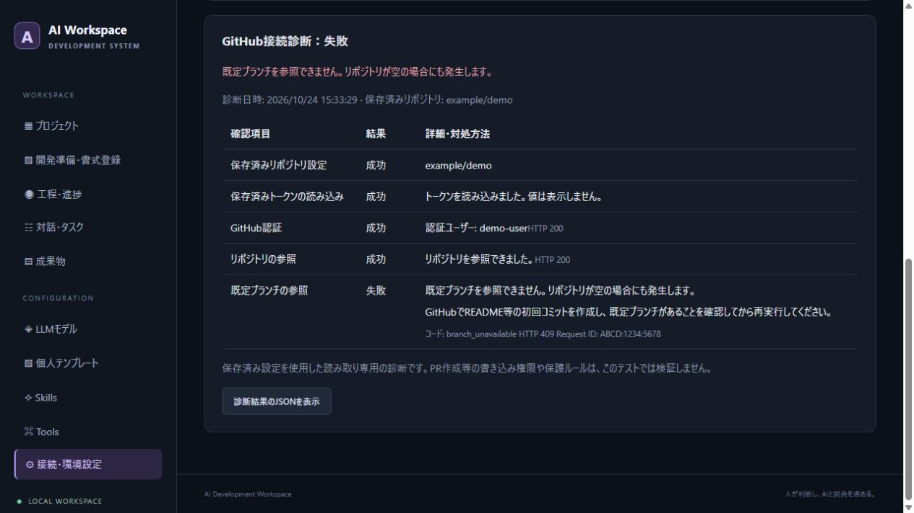

# GitHub接続診断

v0.2.1以降は、短時間で消える通知に加えて、接続テストの診断結果を設定画面に残します。

## 確認方法

1. 「接続・環境設定」でリポジトリとアクセストークンを入力し、「設定を保存」を押します。
2. 「GitHub接続テスト」を押します。
3. 設定フォームの下にある「GitHub接続診断」で、最初に失敗した行の詳細・対処方法を確認します。
4. 問い合わせ時は「診断結果のJSONを表示」から内容をコピーできます。

診断は保存済み設定を使います。GitHub設定が未保存の場合は保存を案内し、通信を開始しません。トークン欄が保存後に空欄になるのは通常の動作です。ラベルの「設定済み」で登録を確認できます。

## 診断項目

| 項目 | 確認内容 |
|---|---|
| 保存済みリポジトリ設定 | owner/repoまたはGitHub URLの指定形式 |
| 保存済みトークンの読み込み | 登録の有無、このWindowsユーザーによる復号 |
| 通信クライアントの初期化 | 配布ファイル、HTTPS、プロキシの通信準備 |
| GitHub認証 | 保存したトークンで認証できるか |
| リポジトリの参照 | 設定したリポジトリを参照できるか |
| 既定ブランチの参照 | 既定ブランチに参照可能なコミットがあるか |

失敗後の項目は「未実行」です。認証が成功してブランチだけ失敗した場合、トークン未登録と判断する必要はありません。

## 主な失敗と対処

| 表示・コード | 対処 |
|---|---|
| token_missing | トークンを入力し、先に設定を保存 |
| credentials_unreadable | アプリと同じWindowsユーザーでトークンを再保存 |
| HTTP 401 / authentication | トークンの期限、失効、入力値を確認 |
| HTTP 403 / permission、sso | 対象リポジトリ、権限、組織の承認・SSOを確認 |
| HTTP 403・429 / rate_limit | 表示された時間だけ待って再実行 |
| HTTP 404 / repository_access | リポジトリ名とトークンのRepository accessを確認。404だけでは不存在と権限不足を区別できない |
| HTTP 404・409 / branch_missing、branch_unavailable | GitHubでREADME等の初回コミットと既定ブランチを作成して再実行 |
| tls_certificate | PCの日時と、社内プロキシ・セキュリティソフトの証明書設定を確認。証明書検証は無効化しない |
| proxy、dns、network、timeout | プロキシ、DNS、回線、api.github.comへのHTTPS通信を確認 |
| client_configuration | プロキシURL等の通信初期化に使う設定を確認。GitHubがトークンを拒否した結果ではない |
| client_resource_missing、client_initialization | exeと_internalを含む新版一式へ更新。トークン復号とは別の通信準備エラー |
| app_connection | exeから画面を開き直す。診断未対応の旧版は新版へ更新 |

HTTPステータスと、取得できた場合はGitHubのRequest IDも表示します。エラーの生の本文、トークン、Authorizationヘッダー、プロキシの資格情報は表示しません。JSONにはユーザー名やリポジトリ名が入るため、共有先は確認してください。

v0.2.1の配布exeにはHTTPS初期化の補助ファイルが不足する不具合があり、その通信準備エラーを「復号できませんでした」と誤表示していた。v0.2.2で同梱を修正し、トークン読み込みと通信初期化を別の段階に分けた。v0.2.1でこの表示が出た場合は、資格情報ファイルを削除する前に新版へ更新する。

Fine-grained tokenのRepository permissionsはContents・Issues・Pull requestsをRead and write、Checks・Commit statusesをRead-onlyにする。Administrationは不要。User permissionsがない表示自体は問題ではない。権限変更の詳細は[GitHub公式の権限一覧](https://docs.github.com/en/rest/authentication/permissions-required-for-fine-grained-personal-access-tokens)を参照。

診断はGETだけを使い、リポジトリを変更しません。成功は読み取り接続の確認です。PR作成等の書き込み権限や、組織・ブランチの保護ルールをすべて検証した結果ではありません。

## exeの更新

旧アプリを画面右上の「終了」で停止し、新しい配布ZIPを別フォルダーに展開してexeを起動します。標準保存先を使っている場合、設定は引き続き同じWindowsユーザーのローカルデータから読み込みます。exeだけでなく、同梱の_internalフォルダーも展開してください。

ソースから調査する場合は、Python環境で `python scripts/github_diagnose.py` を実行できます。設定DBを読み取り専用で開き、同じ診断形式を出力します。独自の保存先は `--data-dir` で指定します。

## 診断画面の例

以下は、認証・リポジトリ参照が成功し、空のリポジトリのブランチ参照がHTTP 409になる模擬APIを使った画面試験です。

画像はv0.2.1時点の表示例です。v0.2.2以降は通信クライアントの初期化を別の行で表示します。

HTTPステータスの解釈は[GitHubのREST APIトラブルシューティング](https://docs.github.com/en/rest/using-the-rest-api/troubleshooting-the-rest-api)、ブランチ参照は[Git references API](https://docs.github.com/en/rest/git/refs)を参照しています。
