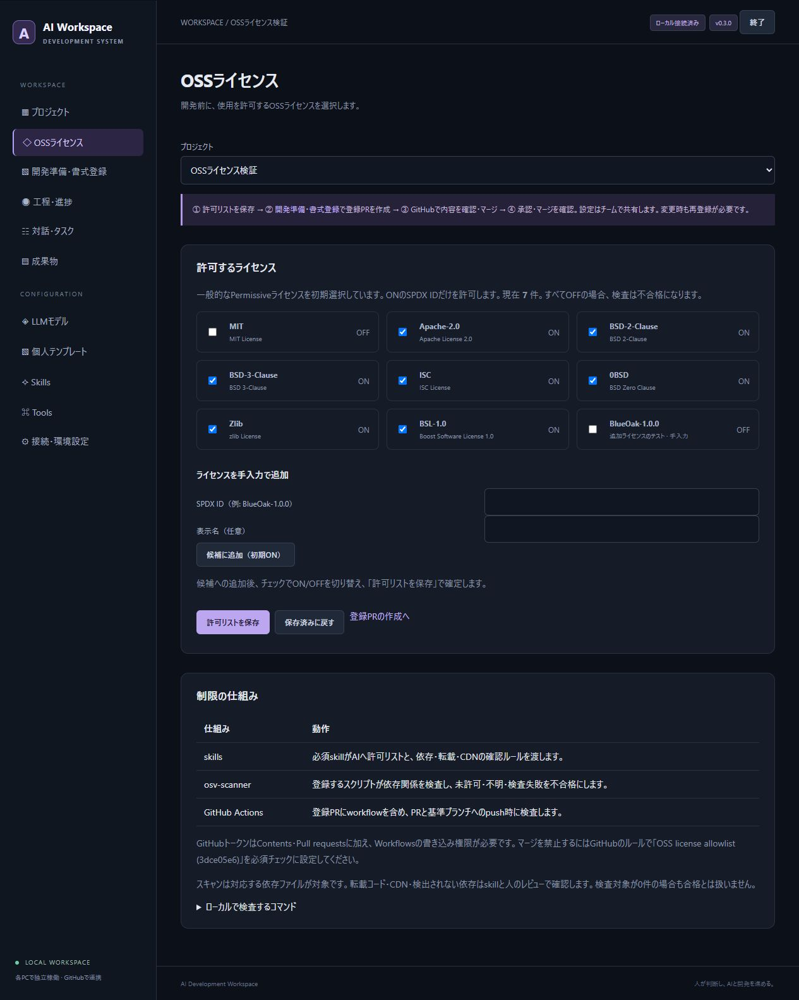

# OSSライセンス設定

開発対象プロジェクトで採用するOSSの許可リストを、プロジェクトの共有設定として保存する。個人の設定だけで他の参加者の許可リストを書き換えず、変更をGitHubの登録PRで確認する。

## 操作

1. プロジェクトを作成し、「OSSライセンス」を開く。
2. 初期候補のMIT、Apache-2.0、BSD-2-Clause、BSD-3-Clause、ISC、0BSD、Zlib、BSL-1.0から許可する項目を選ぶ。初期状態では8件ともON。
3. その他のライセンスはSPDX ID（例: BlueOak-1.0.0）と任意の表示名を入力して「候補に追加」を押す。追加後もチェックでON/OFFを変更できる。
4. 「許可リストを保存」を押す。OFFの候補も保存される。すべてOFFは無制限ではなく、OSS検査を不合格にする設定。
5. 「開発準備・書式登録」で書式を選び、登録PRを作成する。許可リストと3つの制限の仕組みも同じPRに含まれる。
6. GitHubでPRのファイルを確認してマージし、アプリで「承認・マージを確認」を押す。一人開発も本人のマージで通過できる。
7. 「GitHubと同期」で他の参加者へ共有する。参加者もそのPCでマージ済み固定版を確認する。

GitHubのトークンは対象リポジトリのContents・Pull requests・WorkflowsをRead and writeにする。Issues等の従来の権限も維持する。workflowファイルを登録するにはWorkflowsの書き込み権限が必要。[GitHub Contents API](https://docs.github.com/en/rest/repos/contents#create-or-update-file-contents)

許可リストを変更した場合や、v0.2.xの書式登録しかない場合は、登録PRを作り直してマージを確認する。実行中タスクがある間は編集できない。対象版と設定ハッシュが異なる古いPRを確認しても、準備完了にはならない。過去の成果物は生成時の許可リストのハッシュを保持する。

## 3つの制限

| 仕組み | 動作 |
|---|---|
| skills | 必須のoss-license-policy skillを登録する。実行時は共有プロジェクトの選択内容から本文を生成し、許可リスト、直接・推移的依存、転載・CDN・NOTICE等の確認ルールをAIへ渡す。個人skillのOFFや編集で外せない。 |
| osv-scanner | 標準ライブラリだけのPythonスクリプトがOSV-Scanner v2へ許可リストを渡す。全依存のJSONを照合し、未許可、不明、スキャン失敗、対象0件を不合格にする。空のグローバル設定でlicense.ignore等の除外を防ぎ、gitignoreによるスキャン省略も無効にする。 |
| GitHub Actions | PRと基準ブランチへのpush、手動実行で検査するworkflowを登録する。OSV-Scanner v2.6.0を公式配布から取得し、SHA256を照合して実行する。依存パッケージのインストールや対象コードの実行はしない。 |

osv-scannerのライセンス情報はdeps.devに基づく。許可リストにはSPDX IDを渡す。[OSV-Scannerの公式ライセンス検査](https://google.github.io/osv-scanner/usage/license-scanning/)

GitHubのSettings → Rules / Branch protectionで、画面に表示する`OSS license allowlist (<プロジェクトID先頭8文字>)`を必須チェックに設定すると、不合格のPRのマージを防げる。workflowの作成だけでは必須チェックにはならない。アプリはGitHubの保護ルールやトークン権限を自動変更しない。設定やworkflow自体の変更もPRで確認する。

## 登録するファイル

| パス | 内容 |
|---|---|
| `.ai-dev/oss/<project-id>/policy.json` | 表示名、SPDX ID、ON/OFF |
| `.ai-dev/oss/<project-id>/skills/oss-license-policy/SKILL.md` | 当該プロジェクトのAI向けルール |
| `.ai-dev/oss/<project-id>/check_licenses.py` | ローカルとCIで共用する検査スクリプト |
| `.github/workflows/aiworkspace-oss-<project-id>.yml` | GitHub Actions |

書式のlockファイルへ許可リストと各検査ファイルのハッシュを保存する。マージ確認時は固定コミットから内容を取得して照合する。別PCでも同じ検証を行い、確認日時は共有しない。同じリポジトリに複数のプロジェクトを作る場合、各workflowがリポジトリ全体を検査するため、許可方針を揃える。

## ローカルで検査

OSV-Scanner v2とPythonを用意し、登録PRを取り込んだリポジトリのルートから実行する。exeの起動だけなら外部PythonやローカルOSV-Scannerは不要。

```text
python .ai-dev/oss/<project-id>/check_licenses.py --policy .ai-dev/oss/<project-id>/policy.json --root .
```

OSV-ScannerがPATHにない場合は`--scanner <実行ファイルのパス>`、JSONを保存する場合は`--output <結果ファイル>`を追加する。

## 検査範囲と結果

結果はpassed / blocked / errorとパッケージ数、違反、脆弱性の件数をJSONで表示する。終了コード0はライセンス検査の合格、1は不合格または検査失敗。OSV-Scannerの脆弱性件数も記録するが、このゲートの合否はライセンスに基づく。

不明なライセンス、non-standard、複合式や複数ライセンスを自動で都合よく許可しない。報告された各IDが許可されている必要がある。対象なしは依存未検出の可能性があるため合格にせず、対応する依存宣言・ロックファイル・SBOMを確認する。外部依存のないプロジェクトでの「対象なしを許可する」例外機能は設けていない。

スキャナーは対応する依存ファイルを検査する。転載コード、CDN、vendoring等はすべてを自動検出できるわけではないため、skillと人のレビューで取得元・ライセンス・表示義務を確認する。手入力のIDは形式のみ検証し、そのライセンスの実在や条項の適否を自動判定しない。


