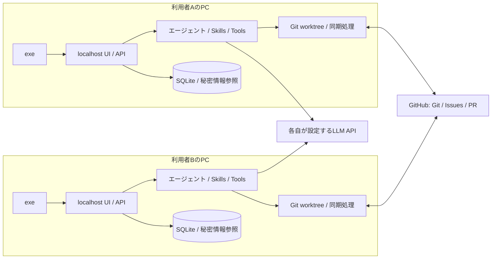

# AI駆動開発システム 要件・構成設計案

追加要件（v0.3.0）: 開発開始前に共有プロジェクトのOSSライセンス許可リストを設定する。一般的なPermissiveライセンス8件を初期ONのチェックリストで表示し、SPDX ID・表示名の手入力追加とON/OFFの保存に対応する。必須skill、osv-scanner、GitHub Actionsで同じ許可リストを使う。登録PRで書式とともに承認・マージし、各ファイルのハッシュを固定する。変更時は登録と最終承認を再評価する。操作と検査範囲は[OSSライセンス設定](oss-license-policy.md)、現行の実装・検証結果は[テスト報告](test-report.md)に記載する。以下の状態欄は初期設計時点の記録。

状態: 要件承認済み（2026-10-24、ユーザーによる会話内承認）。構成設計は案。アプリケーション、exe、外部接続はまだ実装していない。

後続文書: [詳細設計書](detailed-design.md)（画面、状態遷移、データ、API、GitHub同期、最終承認、文書テンプレート、実行制御、受入試験）。

承認範囲は、各PCでのexe起動とブラウザ操作、3つの開発手法に応じた成果物・対話・確認、GitHubを介した共同作業、複数LLM設定、skills/tools拡張とponytail、進捗表示、リーダーによる必須の最終レビュー・承認。これは本システムの要件についての承認であり、将来の開発タスクのGitHub PR承認を代替しない。技術選定、API挙動、性能目標は実装前の検証対象として残す。

追加要件（2026-10-24、ユーザー指定）: 要件定義書・設計書等のMarkdownフォーマットを、ユーザーが設定メニューから登録・編集・選択できること。以下の文書テンプレート仕様に反映する。

## 1. 目的と利用形態

Windowsでexeを起動し、ブラウザからAIエージェントと対話してソフトウェア開発を進める。ユーザーは不足情報への回答、成果物レビュー、工程移行の承認を担当する。文書とソースコードはGitHubで履歴管理し、通常の操作は本システム内で完結させる。GitHubの画面は主にPRレビューに使用する。

初期対象はWindows x64。exeはWebサーバー・画面・ワーカー管理を起動し、ブラウザを開く。終了後の再起動でも途中状態を復元する。開発対象に必要なPython等は設定画面で指定する。exe自身の起動に外部Pythonのインストールは要求しない設計とする。

各利用者が自分のPCでexeを起動し、localhostの画面をブラウザで操作する。各PCにローカルAPI、エージェント、SQLite、Git作業領域を持つ。共同作業は同じGitHubリポジトリを介して行い、専用の共有ホスト、共有DB、PC間の直接通信を必須にしない。

PCを終了するとそのPCのAI実行は停止する。他の利用者の作業は継続できる。再起動時はGitHubの最新状態とローカルの記録を照合して再開する。オフライン中は草案作成を許可するが、共有タスクへの新規着手、共有承認の確定、工程移行、pushやマージは同期回復まで待機する。

## 2. 開発プロセス

プロジェクト作成時に次のメニューを表示する。選択により工程、生成文書、画面、確認タイミングが切り替わる。全プロセスに同じ文書一式を強制しない。

| 選択 | 開始時の成果物 | 主な進め方 | 主な確認点 |
|---|---|---|---|
| ウォーターフォール開発 | 要件定義書、構成設計書 | 要件→構成・基本設計→詳細設計→実装→テスト→リリース | 要件確定、設計確定、テスト結果、リリース |
| アジャイル開発 | プロダクト目標、初期バックログ、受入条件、反復計画 | バックログ整理→計画→実装・テスト→レビュー→振り返りを反復 | 優先順位、反復範囲、受入、次の反復 |
| AI-DLC開発 | 意図、質問・回答、適応的な実行計画 | 初期化・構想整理→Inception→Construction→Operation | 実行計画、作業単位と設計、検証結果、運用移行 |

AI-DLCはAWS由来の方法論を参考にする。採用するワークフローの版と工程定義を固定し、更新時に実行中プロジェクトの定義を自動変更しない。現在の公開ワークフローにはInitialization、Ideation、Inception、Construction、Operationがある。必要工程の選択理由と省略理由を計画に記録する。

ウォーターフォールの要件確定後の変更は変更要求として影響と再承認対象を示す。アジャイルでは各反復のバックログと成果物の版を保持する。AI-DLCでは作業単位ごとに要件・設計・実装・検証を関連付ける。途中で開発手法を変更する場合は、新しい計画を作り既存成果物との対応をユーザーに確認する。

### 必須の最終レビュー・承認

すべての開発手法で、最後に「リーダーによるGitHub上のレビュー・承認」タスクを必ず生成する。このタスクは省略・自動承認できず、承認確認前は開発プロセスを完了扱いにしない。工程途中のユーザー確認とは別に管理する。

プロジェクト作成時に、人間のリーダーをGitHubアカウントで指定する。未指定なら最終承認タスクはブロック状態にし、指定を促す。一人開発では実装担当者・PR作者・リーダーが同一でもよい。GitHubは自己Approveを許可しないため、本人が内容を確認してマージすることで承認に代える。GitHubでマージ済みなら、作者・実行者・レビューの有無にかかわらず確認を通過する。AIによるレビューやブラウザ内の確認だけでは代用しない。

| 開発手法 | 必須タスクの配置 |
|---|---|
| ウォーターフォール | 最終成果物と検証結果を揃えた後、プロセス完了前 |
| アジャイル | 各反復のレビューの最後と、プロジェクト全体の最終完了前 |
| AI-DLC | 各計画済み開発サイクルの最後と、プロジェクト全体の最終完了前 |

「各プロセスの最後」は上記を初期解釈とする。すべての内部タスク・工程末にリーダー承認を増やすことは必須にせず、必要なら追加の工程ゲートとして設定する。

最終承認タスクはGitHub Issueとして登録し、担当リーダー、対象の工程/反復/サイクル、成果物のPR、確認項目、対象commit SHAを記載する。先行する成果物作成・テスト・指摘修正タスクを依存先とし、条件が揃ったら `waiting_approval` にする。ブラウザの進捗画面にリーダー承認待ちとPRへのリンクを表示する。

リーダーはGitHubの対象PRを確認し、マージするか、PR作者とは別のリーダーがApproveする。システムは確認ボタンまたは定期同期で最新のマージ・承認状態を照合する。マージ済みならGitHubの決定を採用し、アプリ側でレビューやCIを追加条件にしない。未マージなら指定リーダー本人による対象版へのApprove、未解消の変更要求がないこと、CI・マージ条件を確認する。対象成果物と最終確認用PRのhead SHAは固定し、版が変わった場合は対象を更新して再確認する。GitHubの保護ルールはそのまま適用する。

対象版への承認が揃ったときだけ、承認者・レビューURL・SHA・時刻を記録し、このタスクを完了する。Issueの手動クローズや単なるコメント、Approveなしのマージだけでは承認済みと判定しない。差戻し時は修正タスクを生成して最終承認を待機に戻し、対象commitや成果物が変わった場合、または承認が取り消された場合は再レビューを要求する。GitHubから確認できない間は承認待ちを維持する。

最終承認はプロセス完了の必須条件であり、PRのマージやデプロイの実行許可とは別に扱う。これらの操作には従来の承認方針とGitHubの保護ルールを適用する。

## 3. ブラウザ画面

1. ホーム: プロジェクト一覧、新規作成、参加、要対応件数。
2. プロジェクト作成: 開発手法、目的、既存/新規リポジトリ、対象ブランチ、参加者、承認方針。
3. 対話: AIの質問、回答、添付文書、選択肢、未解決事項、判断理由。質問と回答を対象タスクに紐付ける。
4. 成果物: Markdown/HTMLの安全なプレビュー、原文、版間差分、レビュー指摘、再生成、承認・差戻し。
5. リアルタイム進捗: 常時アクセス可能な専用画面。工程図、タスクボード、担当者、実行エージェント、承認待ち、失敗、ブロック理由、関連PRを表示する。
6. タスク詳細: 入力、成果物、モデル、実行ログ、テスト結果、依存関係、再試行・停止操作。
7. 設定: LLM、GitHub、実行環境、文書テンプレート、skills、tools、メンバー、権限、予算、通知。

進捗は完了タスク数/計画タスク数と工程状態を表示する。計画追加で分母が変わったことも表示し、LLMの推測による進捗率や残り時間を確定値として出さない。自分のPCの状態は即時配信し、他の利用者の状態はGitHubに同期された情報を定期取得して表示する。各タスクの最終同期時刻、同期失敗、未同期、情報が古い状態を明示する。他PCの生成途中の文章や詳細ログのライブ配信は初期対象外とする。

## 4. LLM・実行環境の設定

複数のLLMプロファイルを登録できる。プロファイルは表示名、プロバイダー、API方式、ベースURL、モデルID、秘密情報参照、コンテキスト上限、出力上限、タイムアウト、同時実行数、利用可否を持つ。接続テストを提供する。

汎用・要件整理・設計・コーディング・レビュー・テスト計画の役割ごとにプロファイルを割り当てる。同じモデルを複数役割に使ってもよい。ユーザーの例である「gpt5.6」「opus5」は表示名として扱い、実際のAPIモデルIDは接続先で確認する。モデル名をコードに固定しない。

API方式はアダプターで吸収する。最初はOpenAI互換APIとAnthropic Messages方式を候補とし、ストリーミング、tool calling、構造化出力、トークン計数の対応差を能力情報として管理する。能力不足なら開始前に知らせる。プロバイダー障害時の別モデルへの切替は設定済みの範囲で行い、機密情報を未承認の接続先に送らない。

GitHub設定はリポジトリURL、基準ブランチ、認証方式、GitHub Enterpriseのホスト、PR方針。各利用者が自分のGitHubアカウントの限定権限トークン等を設定し、その利用者として操作する。ブラウザから秘密情報を入力できるが、再取得APIは値を返さず設定状態のみ返す。秘密情報はWindowsの資格情報ストア等を用いて各PCで保管し、Git・文書・ログに保存しない。他の参加者には共有しない。参加権限はGitHubの権限に従う。

Pythonインタプリター、Git実行ファイル、Node.js等の追加ランタイム、作業ディレクトリ、テストコマンド、許可する実行環境、プロキシ、信頼する証明書、LLM費用上限と実行時間上限も設定可能にする。パスはexeを起動したPC上のパスであることを画面に表示する。LLMの資格情報とモデル割り当てもPCごとに保持する。

## 5. エージェントと人の確認

各PCのローカルコーディネーターが、担当タスクの計画・依存関係・確認待ちを管理し、要件、設計、実装、レビュー、テストの役割に作業を割り振る。役割は論理的に分け、常時すべてのエージェントを起動しない。初期段階では単一ワーカープロセス内の役割切替でも実現できる。

タスク状態は `planned → ready → running → succeeded` を基本とし、`waiting_input`、`waiting_approval`、`blocked`、`failed`、`cancelling`、`cancelled` を持つ。失敗とユーザー待ちは区別する。再試行は新しい実行IDを発行して元の履歴を保持する。

承認は対象成果物のcommit SHAと内容ハッシュ、計画の版、承認者、時刻を固定し、GitHub上にも記録する。対象が変更されたら承認を無効化する。共有する質問・回答と判断記録は、通常の文書と同じくタスクブランチ上のMarkdown/JSONに保存する。ローカルの回答だけでは他PCの工程を進めない。同期後の競合する回答や承認は自動上書きせず、判断待ちにする。PRレビューはGitHub上のレビュー結果を照合する。差戻し理由は次のAI入力に渡す。

自動続行の範囲はプロジェクトで設定する。初期値は情報不足、要件・設計の確定、合意済み範囲の変更、マージ、リリース、破壊的操作で確認する。通常の草案生成と許可済み環境内のテストは自動で進める。保護ブランチのマージ条件はGitHub側の設定も満たす必要がある。

## 6. GitHubと同時実行

- 文書はMarkdownを標準とし、HTMLは必要時の派生物または成果物として扱う。要件・タスク・テストに安定したIDを付けて相互参照する。
- タスクごとにブランチと独立したGit worktreeを用意し、同じ作業ディレクトリを複数エージェントで共有しない。
- リモートにpushされる前の生成物は「ローカル草案」と表示する。共有・承認対象はGitHubに同期済みの版を基本とする。
- 文書変更もソース変更もcommitとPRで追跡する。小さなタスクは作業単位ごとにまとめ、PR数を制御できる。
- ブラウザからPRの状態とCI結果を見られる。レビュー時はGitHubへのリンクを開ける。各PCが外向きの通信で定期取得するため、Webhook受信用の公開サーバーは不要。Issuesをタスク・担当・状態の共有先とし、Projects連携は追加機能にする。
- Issueの担当設定だけを厳密なロックと見なさない。開始前に担当者、実行識別子、関連ブランチを確認する。タスクIDから決まる専用の作業参照をGitHub上に作成し、作成済みなら別の実行として着手しない設計とする。参照の同時作成時の挙動と権限制約は実装前に実APIで検証し、成立しない環境では担当者固定と手動調整に切り替える。
- 作業参照は利用者IDと端末・実行IDを含む所有記録を持つ。更新が途絶えても自動で担当を奪わない。引継ぎは元の実行停止と同期確認を経てブラウザから明示的に行う。再開時やpush・PR更新・工程移行前に所有記録を再確認し、不一致なら停止する。共有サーバーによる厳密な分散実行保証とは区別する。
- 別タスクの同一ファイル編集は許容するが、統合時に基準ブランチとの差分を検査する。競合は専用タスクで解消し、テストと再レビューを行う。
- CI成功だけでは競合を防げないため、基準ブランチ更新後に再検証する。保護ブランチへ直接pushしない。

GitHubは文書・ソースコード・共有計画・共有判断記録・タスク状態の正本とする。各PCのSQLiteは同期キャッシュ、実行チェックポイント、未同期の対話や草案、詳細ログを保持する。GitHubから共有状態は復元できるが、未pushの作業やローカル実行の途中状態は復元できない。別PCへの引継ぎは同期済み成果物から新しい実行を開始し、元PCのプロセスを移動するものではない。PCごとのバックアップ手順を用意する。

## 7. skillsとtools

標準skillsは要件の質問整理、各手法の計画・文書生成、設計レビュー、コードレビュー、テスト設計、GitHub運用、ponytail。ponytailの登録元はユーザー指定の https://github.com/DietrichGebert/ponytail 。配布時に採用commit、ライセンス、必要ファイルを確認して固定する。現時点では未取得・未同梱である。

ブラウザからSKILL.mdの入力/アップロード、GitHub URLからの取り込み、版指定、有効化、適用範囲、更新、無効化ができる。追加時に説明と権限を表示し、各PCの利用者がローカルで有効化する。共有するskill定義と固定版はリポジトリに保存できるが、取得しても各PCで自動実行しない。実行ごとに使用したskillの版を記録する。外部skillの指示でユーザーの要件や承認方針を上書きしない。ponytailは過剰設計を避けるために使用し、指定された機能を無断で省略する根拠にはしない。

標準toolsは作業領域のファイル読み書き、全文検索、Git操作、GitHub API、テスト・ビルド実行、HTTP参照。追加toolはMCPサーバーまたは管理されたコマンドアダプターとして登録する。接続方式、引数、秘密情報参照、権限、タイムアウト、ネットワーク接続先を保持し、接続テストを提供する。

コード実行はサーバー自身と分離したワーカーで行い、作業領域・資格情報・ネットワークを制限する。実行コマンドは引数配列で渡し、任意文字列のシェル結合を避ける。HTMLプレビューはスクリプトを除去し、隔離して表示する。

### 文書テンプレート

文書のフォーマットはユーザーが決められる。主な操作入口は「設定 → 文書テンプレート」とし、skillの作成を必須にしない。標準テンプレートを同梱し、未設定でも利用できる。

| 設定項目 | 内容 |
|---|---|
| テンプレート名・ID | ユーザー向け表示名と安定した識別子 |
| 文書種別 | 要件定義、構成設計、基本設計、詳細設計、テスト計画、バックログ、完了報告等。ユーザー定義種別も追加可能 |
| 適用先 | ウォーターフォール、アジャイル、AI-DLCの工程・成果物種別 |
| 本文 | 見出し、表、記載項目、記入例を含むMarkdown |
| 検証規則 | 必須見出し、見出し順、必須表の列、未記入項目の扱い。本文とは別に設定 |
| 版・保存先 | ローカル個人用、またはGitHubで共有するプロジェクト用 |

ブラウザからMarkdownの直接編集、.mdファイルのアップロード/ダウンロード、リポジトリ内ファイルの選択、標準テンプレートの複製、プレビュー、生成例の確認を行える。生成例はユーザーが実行したときだけLLMを呼び出し、通常のプレビューでは呼び出さない。

生成前に文書種別とテンプレートを表示し、ユーザーは成果物単位で選択を変更できる。初期の選択順は、成果物単位の明示指定、プロジェクトの工程・文書種別設定、個人既定、標準テンプレートとする。共同作業では選択結果を成果物の生成条件として共有し、他のPCが異なる個人既定で勝手に書き換えない。

AIにはテンプレートと記載ガイドを渡し、章構成・表形式を維持して内容を埋めるよう指示する。単なるプロンプトだけに依存せず、生成後に設定済みの必須見出し・順序・表の列と、未置換変数を検証する。内容の妥当性はAIレビューと人のレビューで確認する。違反時は修正を試み、解消できない場合は草案と検証結果を表示して止める。文書を自動的に完成・承認済みにしない。不明事項は捏造せず質問または未決事項として扱う。

変数は `{{project.name}}`、`{{document.title}}`、`{{document.version}}` 等の明示された値に限定し、任意コードを評価しない。AIが埋める箇所は通常のガイド文や `<!-- 記載ガイド: ... -->` として記述できる。例文は実際の要件として取り込まない。最低限の登録フォーマットは以下とする。

```markdown
# {{document.title}}

## 1. 目的
<!-- 記載ガイド: 背景と達成したいことを記載 -->

## 2. 対象範囲
<!-- 記載ガイド: 対象と対象外を記載 -->

## 3. 要件一覧
| ID | 要件 | 優先度 | 受入条件 |
|---|---|---|---|

## 4. 未決事項
<!-- 記載ガイド: 情報が不足する点と確認先を記載 -->
```

共有テンプレートは `.ai-dev/templates/<template-id>/template.md` と `manifest.json` に保存する。manifestには文書種別、適用先、変数、検証規則、参照skillを保持する。変更は通常のブランチ・PRでレビューする。採用commitと本文ハッシュを生成記録に固定し、進行中・承認済み文書をテンプレート更新で自動再生成しない。新しい版への適用は差分を表示して明示的に再生成し、文書が変われば再レビューする。

skillsは文書の書き方・確認観点を補う。skillからテンプレートIDを推奨できるが、ユーザーが選んだフォーマットを上書きしない。ユーザー要件と必須承認、明示選択したテンプレートと検証規則、skillの記載ガイドの順に適用する。競合を解消できなければユーザーに確認する。テンプレートはデータとして読み込み、外部通信やコマンド実行の指示としては扱わない。HTML表示の際は既存のプレビュー隔離方針を適用する。

受入条件は、(1)独自の要件定義・設計書テンプレートをUIから登録できる、(2)選択手法と工程に応じたテンプレートで生成できる、(3)必須項目の欠落を検知する、(4)2台で同じ固定版を利用できる、(5)更新で既存文書や承認が無断変更されない、(6)skillの追加がなくても機能すること。

## 8. 構成案



実装候補はPython/FastAPI、TypeScript/React、SQLite、SSE、PyInstaller。これは未検証の技術選定案であり、使用バージョンとWindows配布方式は実装着手時に確認する。SQLiteは各PCのローカルディスク上に置き、ネットワーク共有フォルダーで共同使用しない。外部DBの導入は不要。

キューは各PCのSQLiteベースとする。ローカルUIへのSSEはイベントIDを保持し、再接続時に取りこぼしを再配信する。ローカルDB更新とイベント登録は同一トランザクションにする。GitHubへの同期は送信待ち操作を永続化し、再起動後も照合してから再試行する。

Web APIはloopbackのみにbindし、起動時のローカルセッション認証、CSRF対策、Origin/Host検証で設定や秘密情報を保護する。GitHubの本人確認と権限を共同作業に適用する。プロジェクトの工程承認ルールは共有設定で定義するが、各PCの設定だけで他利用者のGitHub権限を変更しない。

## 9. データ・APIの骨格

主要データはUser、Project、Membership、WorkflowDefinition、WorkflowRun、Iteration、Task、TaskDependency、AgentRun、Question、Answer、Artifact、Approval、PullRequestLink、ModelProfile、SkillVersion、ToolDefinition、SecretReference、Event、AuditLog。

全データをproject_idで分離する。GitHubのリポジトリ・Issue・PR・commitの識別子と同期時点を保持する。ローカル更新にversion、実行に端末ID・実行ID・所有記録の参照を付ける。承認にはartifact_revisionとplan_revisionを付ける。LLM呼出しにモデル・利用量・時間・費用の見積/実績区分を記録する。対話内容の保存期間と秘密情報のマスキングを設定する。

代表API:

| API | 用途 |
|---|---|
| POST /projects | 手法とリポジトリを指定して作成 |
| POST /projects/{id}/runs | 版を固定したワークフローを開始 |
| GET /projects/{id}/events | SSEで進捗を購読 |
| POST /questions/{id}/answers | 版指定で回答 |
| POST /approvals/{id}/decisions | 対象SHAと版を指定して承認/差戻し |
| POST /tasks/{id}/retry | 新しい実行として再試行 |
| POST /tasks/{id}/cancel | 実行停止を要求 |
| POST /settings/models/{id}/test | モデル接続テスト |
| POST /settings/tools/{id}/test | tool接続テスト |
| POST /projects/{id}/sync | GitHubの変更を取得し送信待ち操作を同期 |
| POST /tasks/{id}/claim | 作業所有記録を確認して着手 |
| POST /tasks/{id}/handover | 停止・同期済みのタスクを明示的に引継ぎ |

変更系APIは認証・権限と冪等キーを検証する。外部APIは再試行可能な失敗と再認証が必要な失敗を区別する。DBとGitHub間は完全な単一トランザクションにできないため、操作IDと照合処理でPR重複作成やpush結果の不確定状態を回復する。

## 10. 実装の段階と受入条件

### 段階1: 対話と永続化

exe起動、3手法選択、複数モデル設定、GitHub接続、質問・回答、Markdown成果物、承認待ちと再開を実装する。各手法で最初の成果物が異なること、再起動後に同じ待ち状態から再開できることを確認する。

文書生成の初期実装にテンプレート登録・編集・選択・検証を含める。ユーザー指定の書式を使えない状態で文書生成を完成扱いにしない。共有テンプレートのGitHub同期は共同作業の実装に含める。

3手法すべてで必須のリーダー最終承認タスクが生成され、未指定・未承認ではプロセスを完了できないことを確認する。GitHub連携実装時には、指定外ユーザーの承認、Issueの手動クローズ、対象版の変更、承認取消し、差戻し、同期失敗で誤って完了しないことと、指定リーダーの有効な承認で完了できることを検証する。

### 段階2: 実装実行とGitHub

隔離ワーカー、worktree、コード生成、テスト、commit/push、PR作成、CI照合を実装する。LLMの失敗・タイムアウト・GitHub制限から復帰でき、再試行でPRやタスクが重複しないことを確認する。

### 段階3: 複数人とリアルタイム表示

2台のPCでそれぞれexeを起動し、GitHubだけを介した同期、所有記録、進捗表示、引継ぎ、競合処理を実装する。別タスクの同時実行、同一タスクへの同時着手検知、回答・承認の競合、PC停止中の他PCの継続、オフライン復帰を確認する。引継ぎ後に旧PCが再開しても所有記録の不一致で停止することを確認する。初期段階から共有ホストを前提にする機能を持ち込まない。

### 段階4: 拡張・運用

ブラウザからのskills/tools追加、ponytail固定版同梱、予算制御、バックアップ復旧、配布更新を実装する。追加skillが権限を越えて実行できないこと、秘密情報がGit・API応答・ログに出ないことを確認する。

進捗表示の初期目標は、自PCの更新から2秒以内、他PCはGitHubへの同期完了から通常30秒以内とする。取得間隔はAPI制限・更新量を考慮して調整し、制限時は待機理由を表示する。仮の負荷条件は10台・合計実行タスク4件とし、実環境で検証して確定する。これは測定済み性能ではない。

## 11. 今後確定する項目

- 各自のWindows PCでexeを起動し、専用の共有ホストを設けない方針は確定。
- 想定利用人数と、他PCの進捗の更新間隔の許容値。
- 実際のLLM接続先、モデルID、API方式、予算、データ送信条件。
- GitHub.com/Enterprise、既存リポジトリの利用方針、認証とPRの承認ルール。
- 開発対象言語、実行隔離方式、配布に含める依存ツール。

## 参考

- AI-DLC公式ワークフロー: https://awslabs.github.io/aidlc-workflows/guide/04-phases-and-stages/
- ユーザー指定ponytail: https://github.com/DietrichGebert/ponytail
