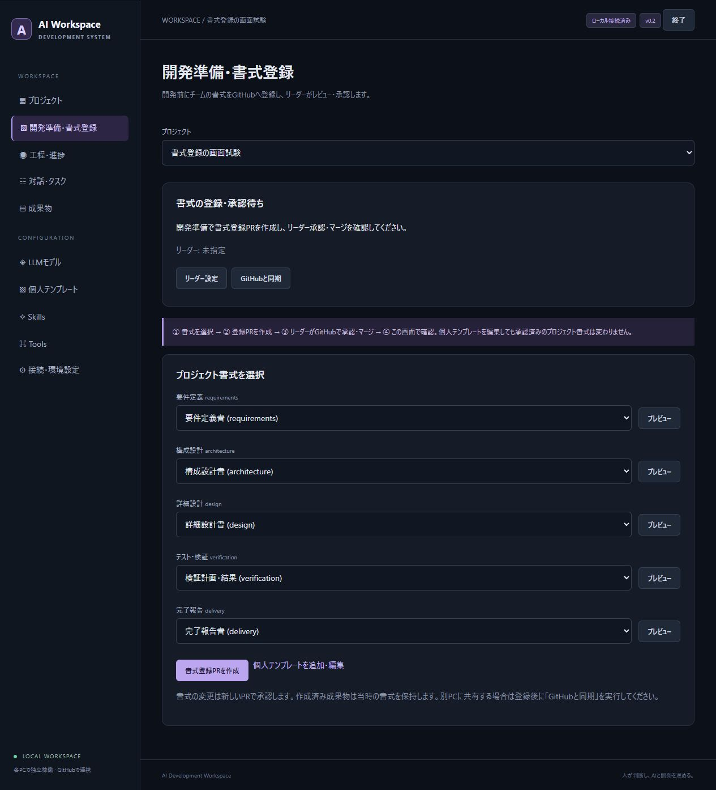

# 実装・テスト報告

## v0.3.0 OSSライセンス許可リスト

2026-10-24（日本時間）にプロジェクト単位のOSSライセンス設定を追加した。Permissiveライセンス8件を初期ONで表示し、SPDX ID・表示名の手入力追加と、候補ごとのON/OFF保存に対応する。設定は共有プロジェクトへ保存し、書式と同じ登録PRへ許可リスト・必須skill・osv-scannerの検査スクリプト・GitHub Actionsを含める。マージコミットとファイルハッシュを照合する。

| 検証 | 結果 |
|---|---|
| 全体の自動テスト | 230件成功。既存の共同作業、承認、書式固定、実行、資格情報も回帰確認 |
| 許可リスト | 初期候補、追加候補、OFF保持、版競合、実行中変更拒否、別PCへの共有、再登録要求を確認 |
| 必須skill | 選択内容をAIのsystemメッセージへ反映。ローカルskillの改変・OFFで除外されない |
| スキャン | 未許可・不明・複合式・空の許可リスト・対象なし・異常JSON・通信/コマンド失敗を合格にしない |
| workflow | 生成YAMLの構文とイベント・権限・コマンドを検証。固定版の公式バイナリとSHA256を使用 |
| 固定版の整合性 | policy・skill・スクリプト・workflowの改変と、許可リスト変更後の古い登録・最終承認を拒否 |
| 実OSV-Scanner | 公式v2.6.0をSHA256照合して実行。six 1.17.0（MIT）は許可時に合格、MITをOFFにすると不合格。chardet 5.2.0は取得した情報がnon-standardとなり不合格 |
| ブラウザ | 初期チェック、OFF、手入力候補の追加・OFF、保存、再読込、登録PR作成・マージ確認、再確認後の再保存を操作。GitHub部分は隔離した模擬環境 |
| Windows exe | ビルド、起動、設定保存、ライセンスのOFF保持と再起動後の復元、従来の暗号化資格情報・模擬LLM接続試験が成功 |
| JavaScript・Python | 構文・コンパイル検証が成功 |

workflowを登録する際の権限不足がAPI制限と誤表示されないよう、HTTP 403と実際の利用制限も分離した。実際の制限では待機秒数・再試行可能時刻を表示する。4件の回帰試験を含む。

実GitHubの利用中リポジトリへの登録・マージや、保護ルールの設定変更は行っていない。workflowの作成だけでマージが禁止されるわけではなく、利用者がGitHubで対応チェックを必須にする必要がある。転載コード・CDN等のすべてを自動検出する機能ではない。検査対象がないプロジェクトを例外許可する機能は設けていない。操作と制約は[OSSライセンス設定](oss-license-policy.md)に記載した。

## v0.2.3 一人開発とマージ済みPRの確認

2026-10-24（日本時間）に承認条件を変更した。書式登録と最終レビューで、GitHub上のmerged=trueとマージコミットを承認の証跡として採用する。PR作者とリーダーの兼任を認め、自己Approveを要求しない。マージ済みならレビューの有無・差戻し・作者・マージ実行者による追加条件や、アプリ側のCI再確認を課さない。未マージの最終レビューは指定リーダーの有効な対象版へのApprove、CI、マージ条件を引き続き確認する。

対象head SHA、リポジトリ、基準ブランチ、書式の固定内容とハッシュ、最終レビューの成果物一覧の検証は維持した。単にclosedのPRや、共有された準備完了フラグだけでは通過しない。マージ証跡とレビュー証跡を区別し、存在しないreview IDを生成しない。確認結果は各PCに保存し、複数PCでの再確認による共有状態の競合を避ける。マージ済みPRでは不要なレビュー一覧APIも呼び出さない。

全体の自動テスト185件、JavaScript構文・Pythonコンパイル検証が成功した。一人開発の書式登録・最終承認API、レビューなし・古いレビュー・差戻し後のマージ、未マージ・版違いの拒否、未マージPRのCI失敗、確認中のレビュー取消し・未マージでのクローズを検証した。既存の複数PC・固定書式・対象ハッシュ・認証の回帰試験も成功した。

Windows exeの再ビルドと隔離したデータでの起動試験も成功した。設定保存、暗号化したダミー資格情報のPython・exe間の読み込み、ローカル模擬LLMへの認証付き接続、未マージ書式の開始拒否、終了、再起動後の復元を確認した。承認機能のAPI試験は模擬GitHubで行い、exe試験から実GitHubのPRを変更していない。

実際のテスト用リポジトリの書式登録PR #1を読み取り専用で取得し、作者とマージ実行者が同じマージ済みPRを新判定が受け入れることも確認した。これは取得したメタデータに対する判定の確認であり、利用中のアプリやDBを操作した試験ではない。ユーザーの資格情報・設定・リポジトリは変更していない。

## v0.2.2 配布exeのHTTPS初期化と誤表示の修正

2026-10-24（日本時間）にv0.2.1のexeで再現した問題を修正した。ビルド用Pythonのsslモジュールが必要とする補助PEMファイルが配布物に含まれず、SSLContext作成時にFileNotFoundErrorとなっていた。従来の診断はトークン読込とHTTPクライアント作成を同じ例外処理で囲み、このエラーを「復号できませんでした」と誤表示していた。

必要なTLS補助データを条件付きで同梱し、元の証明書検証を維持する。標準Pythonで不要な場合は追加しない。参照される必須ファイルがビルド環境にない場合はビルドを停止する。診断はトークン読み込みと通信初期化を分離した。資格情報の保存形式は変更していない。

再発防止としてexe試験を拡張し、ダミー資格情報の保存・Python側での復号、exeでの復号、ローカル模擬LLMへの認証付き接続、再起動後の読み込みを検証する。GitHubへ試験用トークンを送信せず、ユーザーの実際の設定・資格情報は変更しない。以前のexe試験は未登録トークンのケースだけだったため、HTTPクライアント初期化の欠落を検出できていなかった。

全体の自動テスト158件、JavaScript構文検証、Pythonコンパイル検証、ビルド、拡張したexe試験が成功した。追加の手動再現試験では、無効なダミートークンを用いた実GitHubへのHTTPS接続が401となり、復号と通信準備は成功、GitHub認証だけが失敗と正しく表示された。実際のユーザー資格情報を変更・出力していない。

## v0.2.1 GitHub接続診断の追加検証

2026-10-24（日本時間）に接続診断を追加した。保存済み設定、トークン読込、GitHub認証、リポジトリ参照、既定ブランチ参照の各段階と、失敗コード・HTTPステータス・対処方法を表示する。診断結果は短時間の通知だけにせず設定画面に残し、JSONでも確認できる。

- 全体149件のテストと、その後に追加したCLIの読み取り専用検証2件・通信初期化の分類1件が成功。診断関連は計27件、既存分を含め計152件。
- 401、403、404、409、429、5xx、SSO、API制限、証明書、プロキシ、DNS、タイムアウト、資格情報復号エラー、異常応答を検証した。
- 生のエラーにトークンを混ぜた模擬応答でも、結果にトークン・ヘッダー・生のエラー本文を含めないことを確認した。
- ブラウザで段階別表示、対処方法、未保存設定の検出、共有用JSON表示を確認した。画面試験は模擬GitHubを使用。
- Windows exeビルド、診断API、起動、プロジェクト作成、未承認書式の開始拒否、終了、再起動後の保存復元が成功した。
- 実際の保存済み設定による読取診断では認証とリポジトリ参照がHTTP 200、既定ブランチ参照がHTTP 409だった。トークンは表示せず、対象リポジトリを変更していない。これだけで旧exeの接続失敗原因を断定するものではない。

診断は読み取り専用で、書き込み権限・保護ルールの完全な確認ではない。操作と結果の解釈は[接続診断ガイド](github-connection-diagnostics.md)を参照。

以下はv0.2.0での実装・テスト記録。

実施日: 2026-10-24（日本時間） / 対象: v0.2.0

## 変更内容

各PCのexeとローカルブラウザで動作する構成を維持し、共同作業での管理情報の競合と個人書式の上書きを修正した。共有ホストは不要。

- 共有状態をschema version 2のレコード別ブランチへ分離し、変更したレコードだけをSHA比較付きで更新する。
- 承認確認の日時・判定は各PCに保存し、確認のたびに共有タスクを書き換えない。再起動時はそのPCで中断した実行だけを復旧する。
- 所有権と成果物を別ブランチに分離し、引継ぎ後の旧所有者による更新を拒否する。
- 「開発準備・書式登録」で文書種別ごとの書式を選択し、GitHubの登録PRを作成する。
- 指定リーダーの対象SHAへの承認とマージを確認し、マージコミットと書式ハッシュを固定する。準備前はAIタスクを開始できない。
- 個人書式を共有同期から除外し、プロジェクト書式を別領域に保存する。
- 検証では実装成果物を復元して使い、最新結果と対象ハッシュを承認条件にする。テスト中の承認を禁止する。
- 取消中の文書保存、不正IDによる作業領域へのアクセス、終了後に残る子プロセスも修正した。

## 結果

| 検証 | 結果 | 範囲 |
|---|---|---|
| 自動テスト | **125件成功** | DB、3手法、認証・CSRF、対話、共同作業、書式登録、所有権、承認、実装検証、子プロセス終了 |
| JavaScript構文・Pythonコンパイル | 成功 | UI、アプリ、試験スクリプト |
| 実LLM・要件定義 | 成功 | qwythos-9B-v2で質問→回答→Markdown生成、必須見出し違反0件。約119秒 |
| 実LLM・コード生成 | 成功 | calc.pyとtests/test_calc.pyを生成 |
| 生成コードのunittest | **3件成功** | 正数・負数・ゼロの加算、初回実行で成功 |
| ブラウザ操作 | 成功 | プロジェクト作成、書式準備画面、承認前のAI実行ボタン無効化、終了 |
| ローカルGitの実マージ | 成功 | 独立した2成果物ブランチを統合。新規所有者ファイルによる競合なし |
| Windows exe | 成功 | ビルド、HTTP UI、書式未承認時の開始拒否、終了、再起動後の保存復元 |

GitHub ActionsでもWindowsのテスト・ビルド・exe起動試験を行う。CIの最終結果はPRのChecksを参照。

## 共同作業・書式・承認の回帰試験

- 2つの独立DBから別レコードを同時更新でき、同一レコードへの相反する変更は拒否する。
- 同時担当取得は1つだけ成功する。応答消失後の再試行と、引継ぎ後の旧所有者の更新拒否を確認する。
- 複数PCで承認・書式の確認を繰り返しても、共有レコードに確認日時を書き込まない。
- 個人書式を一括送信せず、参加・同期時に同じIDの個人書式を上書きしない。
- 未マージ・未承認・古い承認・異なるリポジトリやブランチ・ハッシュ不一致では準備完了にしない。
- 新PCの共有準備完了フラグだけを信用せず、GitHubを検証した固定版だけを使う。
- 実装成果物を別PCへ共有し、元の作業ディレクトリなしで検証入力を復元する。
- 過去の成功・対象変更前の成功・実行中のテストで承認しない。中断した検証は再起動時に失敗扱いへ復旧する。
- Windowsの改行変換を避け、保存バイト列と検証ハッシュを一致させる。長い作業パスにも対応する。
- 文書修正中の取消では成果物を保存しない。コマンドの時間切れ・正常終了時に残る子プロセスを停止する。

GitHub連携はREST APIに対応する模擬応答、独立DB、ローカルGitで検証した。2台の物理PC、複数の実GitHubアカウント、人間のリーダー承認を通した受入試験は未実施。

## 実LLM試験の条件

ユーザーの起動済みllama-serverへ接続した。モデルIDは qwythos-9B-v2。モデルのダウンロードやサーバー設定変更は行っていない。

書式登録・承認・マージの部分だけを隔離した模擬GitHubへ接続し、アプリ本体の準備確認処理を通してから実LLMを呼び出した。実GitHubへ試験用PRを作成したものではない。コード試験は計画工程を完了済みとするfixtureを使っている。全工程を実LLM・人間の承認で通したE2Eではない。

詳細ログは .runtime/live-llm-preflight-1/report.json、.runtime/live-code-preflight-1/report.json、自動試験は test-results/junit.xml に保存する。Git管理対象外であり、資格情報や個人の絶対パスを公開用報告に転載しない。

Starletteのhttpx TestClientに関する非推奨警告が1件ある。テスト失敗ではない。

## 配布・移行・制約

dist/AIWorkspace/AIWorkspace.exe を含むフォルダーを配布する。設定・資格情報・試験用DBは含めない。署名付き配布と自動更新は未実装。

旧版の参加者は全員を更新してから同期する。schema version 1の shared.json は読み取り移行のみ。旧版と新版で同時に書き込まない。既存作業ブランチの owner.json は自動で履歴を書き換えない。手順は[共同作業と書式登録](collaboration-formats.md)を参照。

同じソース箇所や同じ共有レコードに異なる変更を加えた場合の競合は残る。同期は一括トランザクションではなく、部分成功後は安全に再試行する。競合の手動統合UIは未実装。

他PCの進捗は通常30秒間隔でGitHubから取得し、このPC内の更新はSSEで画面へ反映する。生成途中の文章をPC間で配信する仕組みではない。

構造検証やテスト成功は、文書内容・全要件の正しさを保証しない。人のレビューと差戻しを前提とする。既存ソースツリーの自動checkout等の未実装範囲は[README](../README.md)を参照。

## 書式登録画面

