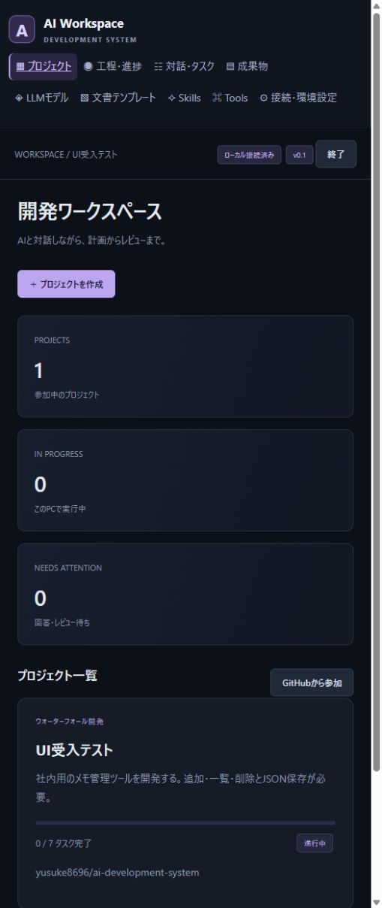

# 実装・テスト報告

実施日: 2026-10-24（日本時間）

## 対象

Windows各PCでexeを起動するブラウザアプリの初期実装。対象コードは `ai_system/`、`launcher.py`、ビルド・試験スクリプト。ユーザー指定リポジトリは `yusuke8696/ai-development-system`。

LLMはユーザーの起動済みllama-serverに接続し、モデルID `qwythos-9B-v2`、コンテキスト16384の公開情報を確認した。モデルのダウンロードやサーバー設定の変更は行っていない。

## 結果

| 検証 | 結果 | 範囲 |
|---|---|---|
| 自動テスト | **57 passed** | ローカルDB、版競合、3手法、テンプレート、パス制限、認証・CSRF、複数モデル、対話、tool制御、模擬GitHub同期、最終承認 |
| JavaScript構文確認 | 成功 | `node --check ai_system/web/app.js` |
| Pythonコンパイル確認 | 成功 | `compileall` |
| 実LLM・文書生成 | 成功 | 質問→試験用回答→再開→Markdown要件定義生成→必須見出し検証。約77秒 |
| 実LLM・コード生成 | 修正後成功 | 当初はsrc配置とimportの不一致で失敗。失敗結果と配置条件を入力し直してAIが修正 |
| AI生成コードのテスト | **3 passed** | 生成されたadd関数に対する正数・負数・ゼロのunittest |
| Windows exeビルド | 成功 | PyInstaller、Python実行環境・UI・ponytailを同梱 |
| Windows exe実行 | 成功 | 起動、HTTP UI、プロジェクト作成、7タスク生成、終了、再起動後の復元 |
| ブラウザ手動操作試験 | 成功 | プロジェクト作成、進捗画面、独自Markdownテンプレートの登録・一覧反映 |
| GitHub実リポジトリ読取 | 成功 | 空リポジトリの取得、メタデータ・権限の確認 |

実LLMのコード試験は、計画工程を完了扱いにした試験fixtureから実装を開始している。全工程を実LLMで通したE2Eではない。テスト0件のunittest実行は成功扱いにしない。

自動テストにはStarletteのhttpx TestClientに関する非推奨警告が1件ある。テスト失敗ではない。実行の詳細はGit管理対象外のJUnitレポートとローカル試験ディレクトリに保存する。資格情報と個人の絶対パスを公開用レポートへ転載しない。

## 承認・共同作業の確認事項

- 同じタスクを2端末が取得した場合に一方を拒否し、別タスクは双方で取得できる。
- 独立した2つのローカルDBの異なる変更は共有でき、同じレコードの競合ではローカルの変更を保持する。
- 引継ぎ後の旧所有者は公開操作を止める。
- 最終タスクは画面の通常承認APIで完了できない。
- 指定外ユーザー、bot、古いSHA、COMMENTED、DISMISSED、未解消の変更要求を承認にしない。
- 有効な承認で完了し、取消し・対象PRの変更・追加タスク・先行タスク未完了で再度承認待ちにする。
- アジャイルの反復完了だけではプロジェクト全体を完了せず、全体の最終承認タスクを追加する。

これらは模擬APIを使った検証である。実GitHubでの参照同時作成、2台の実PC・複数アカウント、人間のリーダー承認、PR作成後のCI連動は未検証。

## 文書内容の限界

Markdownの構造検証が通っても、内容の正しさまでは保証しない。実LLMの試験出力には「削除前の取消し」の条件を「削除後の再追加」と読み替える記述も見られた。生成物は草案として人がレビューし、修正・差戻しする必要がある。これはモデルの出力品質に関する確認結果であり、全要件が自動的に正しく生成できたという報告ではない。

## 配布とGitHub公開

`dist/AIWorkspace/AIWorkspace.exe` を含むフォルダーを配布する。端末固有データ・資格情報・試験用DBを配布物に含めない。

ユーザーの明示承認を受け、READMEだけの初期commitをmainへ登録し、実装は `feature/local-ai-workspace` へpushした。[PR #1](https://github.com/yusuke8696/ai-development-system/pull/1) を作成済み。リーダーによるレビュー・承認とマージは未実施。

## 設計との対応

要件・詳細設計の文書は実装前の設計として保存する。現時点の対応範囲と未実装項目は [README](../README.md#現時点の範囲と設計との差分) を参照。初期実装を全設計の完成・本番受入済みと扱わない。

## 画面

